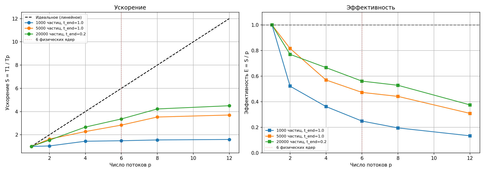

# Задача N тел

Нужно посчитать траектории N материальных точек от 0 до `t_end`. На точку заданы масса, начальные координаты и скорость. Сила берётся из закона тяготения, шаг по времени делается методом Эйлера первого порядка.

Запуск:

```text
./nbody t_end input.txt [nthreads] [dt] [output.csv]
```

Во входном файле первая строка — это `n`, дальше `n` строк по семь чисел: масса, `x y z`, `vx vy vz`. В методичке формулы Эйлера записаны для `x` и `y`, а во входном файле есть ещё `z`. Считаю движение в трёхмерном пространстве, а в CSV пишу только `x` и `y`, как просят в выводе:

```text
t, x1, y1, x2, y2, ..., xn, yn
```

Каждая строка — это координаты в конкретный момент времени. Шаг `dt` в условии не задан, в замерах он равен 0.01 с. К квадрату расстояния добавляется `1e-30`, чтобы не делить на ноль, если две точки совпали. На обычных расстояниях это слагаемое ничего не меняет.

## Алгоритм

Сила на тело `i` со стороны тела `j`:

```text
F = G * mi * mj * (rj - ri) / |rj - ri|^3
G = 6.67430e-11
```

Пара `(i, j)` считается один раз. На `i` прибавляется `F`, на `j` прибавляется `-F`. Это третий закон Ньютона, он сокращает число пар вдвое.

Положения и скорости на шаге `n` берутся из значений шага `n-1`. Сначала все силы считаются по старым координатам, и только потом обновляются координаты и скорости:

```text
x  = x  + vx * dt
vx = vx + Fx / m * dt
```

То же самое для `y` и `z`. Если обновить координату раньше, чем посчитаны все силы, на одном шаге разные пары увидят разные положения.

## Как это сделано в коде

Тяжёлая часть — перебор пар, их `n(n-1)/2`. Этот диапазон делится поровну между потоками. Поток не пишет сразу в общий массив сил: у каждого свой `Fx_loc[tid]`. Иначе два потока, обрабатывающие разные пары одного и того же тела, затирали бы друг другу силу.

Дальше на каждом шаге четыре барьера.

1. Все потоки закончили свои пары.
2. Каждый поток складывает куски силы для своей группы тел. После этого у тела одна полная сила.
3. Те же группы тел обновляют координаты и скорости.
4. Главный поток записывает строку CSV и, если время вышло, ставит флаг остановки. Потоки не начинают следующий шаг, пока эта запись не закончилась.

Главный поток сам пары не считает. Он нужен, чтобы шаги не разъехались: силу нельзя суммировать, пока кто-то ещё пишет локальный массив, и нельзя читать координаты для файла, пока кто-то их меняет.

## Где и как мерилось время

| | |
|---|---|
| Процессор | Intel Core i5-13420H, 6 ядер, 12 потоков |
| Память | 3.7 ГБ, выделено WSL2 |
| Система | Ubuntu 22.04.5, ядро 6.6.87.1-microsoft-standard-WSL2 |
| Сборка | gcc 11.4.0, флаги `-O2 -pthread` |

Время берётся через `clock_gettime(CLOCK_MONOTONIC)` вокруг цикла по шагам. Чтение входного файла в замер не входит. Запись CSV входит: строка пишется на каждом шаге внутри этого цикла. Для 20 000 частиц запись мала рядом с перебором пар, для 1000 частиц она уже заметна. Если параметр `dt` не передан явно, программа использует значение по умолчанию 1.0 с, однако все замеры в таблицах ниже проводились с шагом `dt = 0.01` с.

Каждая пара «число частиц, число потоков» запускалась 5 раз. В таблицы положен минимум. Ускорение `S = T(1) / T(p)`, эффективность `E = S / p`.

## Результаты

1000 частиц, `t_end = 1.0`, `dt = 0.01`, 100 шагов:

| Потоки | Минимум, с | S | E |
|---:|---:|---:|---:|
| 1 | 0.8923 | 1.00 | 1.00 |
| 2 | 0.8552 | 1.04 | 0.52 |
| 4 | 0.6161 | 1.45 | 0.36 |
| 6 | 0.5987 | 1.49 | 0.25 |
| 8 | 0.5722 | 1.56 | 0.19 |
| 12 | 0.5575 | 1.60 | 0.13 |

5000 частиц, `t_end = 1.0`, `dt = 0.01`:

| Потоки | Минимум, с | S | E |
|---:|---:|---:|---:|
| 1 | 17.3158 | 1.00 | 1.00 |
| 2 | 10.6001 | 1.63 | 0.82 |
| 4 | 7.5942 | 2.28 | 0.57 |
| 6 | 6.1042 | 2.84 | 0.47 |
| 8 | 4.9023 | 3.53 | 0.44 |
| 12 | 4.6741 | 3.70 | 0.31 |

20 000 частиц, `t_end = 0.2`, `dt = 0.01`, 20 шагов:

| Потоки | Минимум, с | S | E |
|---:|---:|---:|---:|
| 1 | 63.9812 | 1.00 | 1.00 |
| 2 | 41.5130 | 1.54 | 0.77 |
| 4 | 23.9883 | 2.67 | 0.67 |
| 6 | 19.0094 | 3.37 | 0.56 |
| 8 | 15.1357 | 4.23 | 0.53 |
| 12 | 14.2081 | 4.50 | 0.38 |



На 1000 частицах 12 потоков дают только 1.6 раза. Перебор пар здесь короткий, а на каждом шаге все потоки четыре раза ждут друг друга, плюс главный поток пишет CSV. На 20 000 частицах пар уже около 200 миллионов на шаг, и ускорение доходит до 4.5 на 12 потоках.

До 6 потоков время падает заметно: у процессора 6 физических ядер. На 8 и 12 потоках прирост меньше. Это уже гиперпоточность, второе логическое ядро делит те же блоки исполнения. Эффективность при этом всё равно снижается: барьеры и поток, который только записывает файл, от числа потоков быстрее не становятся.

Самый большой выигрыш от третьего закона Ньютона не в графике, а в объёме работы. Без него пар было бы в два раза больше, и каждый шаг сил стоил бы примерно вдвое дольше.

## Приложение. Листинг `nbody.c`

```c
#define _POSIX_C_SOURCE 200809L
#include <stdio.h>
#include <stdlib.h>
#include <string.h>
#include <math.h>
#include <pthread.h>
#include <time.h>

static const double G = 6.67430e-11;

typedef struct {
    int n;
    double dt;
    double t_end;
    int nthreads;
    volatile int stop;

    double *m;
    double *x, *y, *z;
    double *vx, *vy, *vz;
    double *Fx, *Fy, *Fz;

    double **Fx_loc, **Fy_loc, **Fz_loc;

    pthread_barrier_t barrier;
    FILE *out;
} world_t;

typedef struct {
    world_t *w;
    int tid;
} thread_arg_t;

static int read_input(const char *fname, world_t *w) {
    FILE *f = fopen(fname, "r");
    if (!f) { perror("fopen input"); return -1; }

    if (fscanf(f, "%d", &w->n) != 1) { fclose(f); return -1; }
    int n = w->n;
    if (n <= 0) { fclose(f); return -1; }

    w->m  = malloc(sizeof(double) * n);
    w->x  = malloc(sizeof(double) * n);
    w->y  = malloc(sizeof(double) * n);
    w->z  = malloc(sizeof(double) * n);
    w->vx = malloc(sizeof(double) * n);
    w->vy = malloc(sizeof(double) * n);
    w->vz = malloc(sizeof(double) * n);
    w->Fx = calloc(n, sizeof(double));
    w->Fy = calloc(n, sizeof(double));
    w->Fz = calloc(n, sizeof(double));

    if (!w->m || !w->x || !w->y || !w->z || !w->vx || !w->vy || !w->vz
        || !w->Fx || !w->Fy || !w->Fz) {
        fclose(f);
        return -1;
    }

    for (int i = 0; i < n; i++) {
        if (fscanf(f, "%lf %lf %lf %lf %lf %lf %lf",
                   &w->m[i], &w->x[i], &w->y[i], &w->z[i],
                   &w->vx[i], &w->vy[i], &w->vz[i]) != 7) {
            fprintf(stderr, "Bad line %d\n", i);
            fclose(f);
            return -1;
        }
    }
    fclose(f);
    return 0;
}

static void alloc_local(world_t *w) {
    int n = w->n, T = w->nthreads;
    w->Fx_loc = malloc(sizeof(double*) * T);
    w->Fy_loc = malloc(sizeof(double*) * T);
    w->Fz_loc = malloc(sizeof(double*) * T);
    for (int t = 0; t < T; t++) {
        w->Fx_loc[t] = calloc(n, sizeof(double));
        w->Fy_loc[t] = calloc(n, sizeof(double));
        w->Fz_loc[t] = calloc(n, sizeof(double));
    }
}

static void *worker(void *arg) {
    thread_arg_t *ta = (thread_arg_t *)arg;
    world_t *w  = ta->w;
    int tid     = ta->tid;
    int T       = w->nthreads;
    int n       = w->n;
    double dt   = w->dt;

    long total_pairs = (long)n * (n - 1) / 2;
    long p_start = total_pairs * tid / T;
    long p_end   = total_pairs * (tid + 1) / T;

    int i_start = n * tid / T;
    int i_end   = n * (tid + 1) / T;

    while (1) {
        for (int i = 0; i < n; i++) {
            w->Fx_loc[tid][i] = 0.0;
            w->Fy_loc[tid][i] = 0.0;
            w->Fz_loc[tid][i] = 0.0;
        }

        long p = 0;
        for (int i = 0; i < n - 1; i++) {
            long row_len = n - i - 1;
            long row_end = p + row_len;

            if (row_end <= p_start) { p = row_end; continue; }
            if (p >= p_end) break;

            int j_start = i + 1;
            if (p < p_start) {
                j_start = i + 1 + (int)(p_start - p);
                p = p_start;
            }

            for (int j = j_start; j < n && p < p_end; j++, p++) {
                double dx = w->x[j] - w->x[i];
                double dy = w->y[j] - w->y[i];
                double dz = w->z[j] - w->z[i];
                double r2 = dx*dx + dy*dy + dz*dz + 1e-30;
                double r  = sqrt(r2);
                double inv_r3 = 1.0 / (r2 * r);
                double F  = G * w->m[i] * w->m[j] * inv_r3;

                double Fx = F * dx;
                double Fy = F * dy;
                double Fz = F * dz;

                w->Fx_loc[tid][i] += Fx;
                w->Fy_loc[tid][i] += Fy;
                w->Fz_loc[tid][i] += Fz;

                w->Fx_loc[tid][j] -= Fx;
                w->Fy_loc[tid][j] -= Fy;
                w->Fz_loc[tid][j] -= Fz;
            }
        }

        pthread_barrier_wait(&w->barrier);

        for (int i = i_start; i < i_end; i++) {
            double Fx = 0.0, Fy = 0.0, Fz = 0.0;
            for (int t = 0; t < T; t++) {
                Fx += w->Fx_loc[t][i];
                Fy += w->Fy_loc[t][i];
                Fz += w->Fz_loc[t][i];
            }
            w->Fx[i] = Fx;
            w->Fy[i] = Fy;
            w->Fz[i] = Fz;
        }

        pthread_barrier_wait(&w->barrier);

        for (int i = i_start; i < i_end; i++) {
            w->x[i] += w->vx[i] * dt;
            w->y[i] += w->vy[i] * dt;
            w->z[i] += w->vz[i] * dt;

            w->vx[i] += w->Fx[i] / w->m[i] * dt;
            w->vy[i] += w->Fy[i] / w->m[i] * dt;
            w->vz[i] += w->Fz[i] / w->m[i] * dt;
        }

        pthread_barrier_wait(&w->barrier);
        pthread_barrier_wait(&w->barrier);

        if (w->stop) break;
    }
    return NULL;
}

static void write_state(world_t *w, double t) {
    fprintf(w->out, "%.6f", t);
    for (int i = 0; i < w->n; i++) {
        fprintf(w->out, ",%.10e,%.10e", w->x[i], w->y[i]);
    }
    fprintf(w->out, "\n");
}

int main(int argc, char **argv) {
    if (argc < 3) {
        fprintf(stderr, "Usage: %s t_end input.txt [nthreads] [dt] [output.csv]\n", argv[0]);
        return 1;
    }

    double t_end = atof(argv[1]);
    const char *infile = argv[2];
    int nthreads = (argc >= 4) ? atoi(argv[3]) : 4;
    double dt = (argc >= 5) ? atof(argv[4]) : 1.0;
    const char *outfile = (argc >= 6) ? argv[5] : "results/trajectory.csv";

    if (nthreads <= 0) { fprintf(stderr, "nthreads must be > 0\n"); return 1; }
    if (dt <= 0.0)     { fprintf(stderr, "dt must be > 0\n");       return 1; }

    world_t w;
    memset(&w, 0, sizeof(w));
    w.dt       = dt;
    w.t_end    = t_end;
    w.nthreads = nthreads;

    if (read_input(infile, &w) != 0) {
        fprintf(stderr, "Failed to read input\n");
        return 1;
    }

    alloc_local(&w);

    pthread_barrier_init(&w.barrier, NULL, nthreads + 1);

    w.out = fopen(outfile, "w");
    if (!w.out) { perror("fopen out"); return 1; }

    write_state(&w, 0.0);

    pthread_t *threads    = malloc(sizeof(pthread_t) * nthreads);
    thread_arg_t *args    = malloc(sizeof(thread_arg_t) * nthreads);
    for (int t = 0; t < nthreads; t++) {
        args[t].w   = &w;
        args[t].tid = t;
        if (pthread_create(&threads[t], NULL, worker, &args[t]) != 0) {
            perror("pthread_create");
            return 1;
        }
    }

    struct timespec t0, t1;
    clock_gettime(CLOCK_MONOTONIC, &t0);

    double t = 0.0;
    while (1) {
        pthread_barrier_wait(&w.barrier);
        pthread_barrier_wait(&w.barrier);
        pthread_barrier_wait(&w.barrier);

        t += dt;
        write_state(&w, t);

        if (t >= t_end - 1e-9) {
            w.stop = 1;
        }

        pthread_barrier_wait(&w.barrier);
        if (w.stop) break;
    }

    clock_gettime(CLOCK_MONOTONIC, &t1);
    double elapsed = (t1.tv_sec - t0.tv_sec) + (t1.tv_nsec - t0.tv_nsec) * 1e-9;
    printf("Elapsed: %.6f sec\n", elapsed);

    for (int i = 0; i < nthreads; i++) pthread_join(threads[i], NULL);

    pthread_barrier_destroy(&w.barrier);
    fclose(w.out);
    free(threads);
    free(args);
    free(w.m);  free(w.x);  free(w.y);  free(w.z);
    free(w.vx); free(w.vy); free(w.vz);
    free(w.Fx); free(w.Fy); free(w.Fz);
    for (int t = 0; t < nthreads; t++) {
        free(w.Fx_loc[t]); free(w.Fy_loc[t]); free(w.Fz_loc[t]);
    }
    free(w.Fx_loc); free(w.Fy_loc); free(w.Fz_loc);

    return 0;
}
```